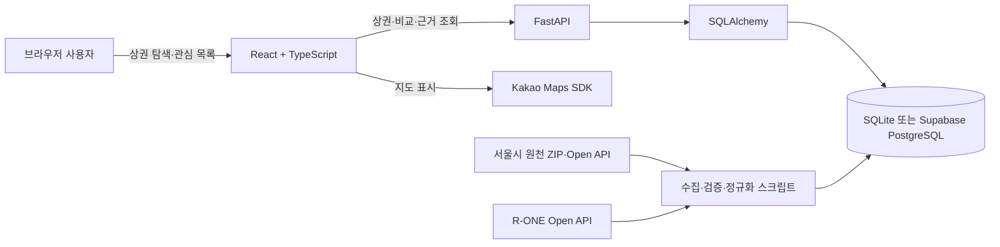
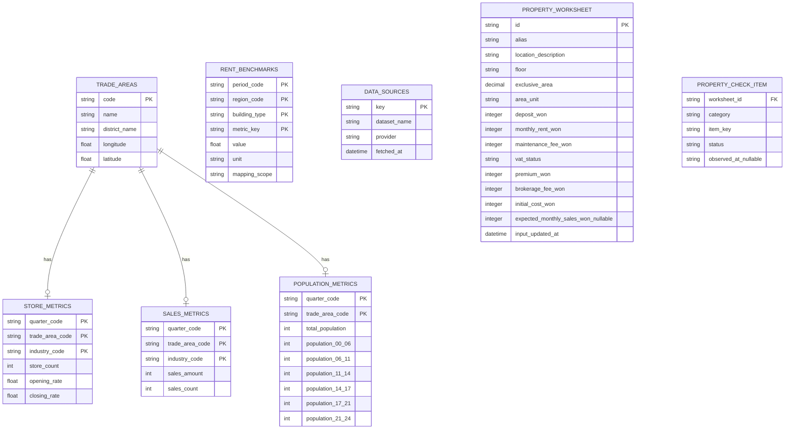

# 골목 레이더 구조와 API

## 시스템 흐름

관심 상권 코드는 브라우저 `localStorage`의 `golmok-radar:favorites:v1`에만 저장됩니다. FastAPI는 읽기 API를 제공하며 성공 예측이나 사용자 프로필은 만들지 않습니다. Phase 19의 매물 검증 워크시트는 `golmok-radar:property-worksheets:v1`에만 저장하며 서버로 전송하지 않습니다.

## 데이터 모델

점포·매출은 `기준분기 + 상권코드 + 업종코드`, 인구는 `기준분기 + 상권코드`가 논리 키입니다. 원천 행이 없으면 계산 계층은 0으로 대체하지 않고 `unavailable`과 사유를 반환합니다.

### Phase 19 워크시트 로컬 모델과 계산 계약

`PROPERTY_WORKSHEET`와 `PROPERTY_CHECK_ITEM`은 서버 DB 테이블이 아니라 localStorage JSON 스키마를 설명하는 논리 모델입니다. `id`는 브라우저에서 생성한 식별자이며, 매물 별칭·위치 설명·층수·면적·비용·입력일과 현장 확인 상태를 묶습니다. 주소 기반 자동 조회, 서버 저장, 계정 동기화, 매물 API 연결은 범위 밖입니다.

- `area_unit`은 `sqm` 또는 `pyeong`만 허용하고, `exclusive_area`는 0보다 커야 합니다. 면적당 월 공간비 계산 시 `pyeong × 3.305785`로 ㎡ 환산합니다.
- 금액 필드는 원 단위 0 이상 정수이며, `expected_monthly_sales_won`만 선택 입력입니다. 빈 값은 0이 아닙니다.
- `vat_status`는 포함, 별도, 확인 필요 중 하나이며, 확인 필요는 월세·관리비를 자동 보정하지 않습니다.
- `status`는 `confirmed`, `needs_follow_up`, `not_applicable`, `not_recorded` 중 하나입니다. 건축물 용도·영업 가능 여부·특약·원상복구는 공식 기관 또는 전문가 확인 필요를 함께 표시합니다.
- 계산값은 저장하지 않고 입력값에서 재계산합니다. 초기 투입비는 보증금+권리금+중개수수료+초기 비용, 월 공간비는 월세+관리비입니다. 해당 구성값 누락 시 `input_required`; 면적·예상 월매출의 0 또는 누락 분모는 `unavailable`과 사유를 반환합니다.

워크시트 값은 서울시 상권 통계나 R-ONE 벤치마크와 결합·추정·자동 비교하지 않습니다. 화면에서는 각각의 출처, 기준분기 또는 입력일, 공간 단위를 구분합니다.

## HTTP API

| Method | 경로 | 용도 |
| --- | --- | --- |
| GET | `/health` | 앱·DB 상태 확인 |
| GET | `/api/v1/trade-areas` | 서울 25개 자치구 상권 목록과 데이터 보유 상태 |
| GET | `/api/v1/trade-areas/{code}` | 상권 상세와 지표 |
| GET | `/api/v1/trade-areas/{code}/map-insight` | 지도 선택용 상권 단위 유동·카페 매출·시간대 비중; 계산 불가 사유와 데이터 경계 포함 |
| POST | `/api/v1/recommendations` | 창업 성향 답변 기반 설명 가능한 카페 후보 2~3곳 |
| GET | `/api/v1/trade-areas/{code}/report` | 완전 데이터 상권 1,068곳 비교군 기준 강점·주의·수요 특성 리포트 |
| GET | `/api/v1/trade-areas/{code}/rent-benchmark` | R-ONE 서울 전체 소규모상가 참고지표와 공간 범위·공식 출처 확인 |
| GET | `/api/v1/rent-markets` | R-ONE 서울 세부 조사상권 59곳의 코드·이름·권역·기준기간 조회 |
| GET | `/api/v1/trade-areas/{code}/rent-benchmark?market_code={R-ONE코드}` | 선택한 R-ONE 조사상권과 서울 전체의 임대료·공실률·임대가격지수 비교 |
| POST | `/api/v1/support-programs` | 최소 조건 기반 공식 창업지원 연동 상태와 후보 확인 |
| POST | `/api/v1/review-analysis` | 사용자 제공 리뷰의 주제별 내 가게·주변 비교군 분석 |
| GET | `/api/v1/comparisons?codes=A,B&quarter=20254` | 서로 다른 상권 2~4곳, 지표 14개 비교 |
| GET | `/api/v1/comparisons/{comparison_id}/evidence/{metric_key}` | 지표 출처·필터·수식·원천값 확인 |
| GET | `/api/v1/field-checklist` | 현장 확인 질문 5개 |

Phase 19는 워크시트용 FastAPI 엔드포인트를 추가하지 않습니다. 프런트엔드의 순수 계산 모듈은 아래의 내부 계약으로만 구현합니다.

| 함수 또는 경계 | 목적 |
| --- | --- |
| `parsePropertyWorksheet` | localStorage JSON을 검증하고 손상·구버전 값은 안전하게 제외 |
| `calculatePropertyWorksheet` | 입력값에서 초기 투입비·월 공간비·면적당 월 공간비·선택 입력 매출 대비 비율과 상태·사유 계산 |
| `savePropertyWorksheets` | 유효한 사용자 입력만 `golmok-radar:property-worksheets:v1`에 저장 |
| `loadPropertyWorksheets` | 브라우저 저장값 복구; 서버 요청·주소 조회를 수행하지 않음 |

비교 API는 코드 1개·5개 이상·중복·없는 코드·미지원 분기를 거부합니다. 프런트엔드는 금액, 비율, 점포 수 단위를 구분하며 결측 사유를 각 셀에 표시합니다.

`map-insight`는 `PopulationMetric`과 카페(`CS100010`) `SalesMetric`의 같은 기준분기 행만 읽습니다. 시간대 막대의 비율은 백엔드에서 `시간대 유동인구 ÷ 총 유동인구 × 100`으로 계산하고, 프런트엔드는 반환된 비율만 표시합니다. 위치는 `TradeArea` 중심점이며, 거리별 좌표·연령대 유동인구·개별 매물 데이터는 응답과 화면에 포함하지 않습니다.

## 검증 기준

| 계층 | 검증 |
| --- | --- |
| 수집 | API 보고 행 수와 저장 행 수, 필수 컬럼, 기준분기 확인 |
| 적재 | 새 DB 적재, 논리 키 중복, 상권 코드 결합, 예상 행 수 확인 |
| 계산 | 정상·경계·결측 사례를 엑셀 손계산표와 pytest로 대조 |
| API | 2·3·4곳 성공 및 잘못된 코드 수·중복·분기 실패 테스트 |
| UI | 서울 공식 상권 1,650곳 로딩, 관심 목록 유지, 최대 4곳 제한, 14지표·결측·근거 패널 확인 |

2026-10-30 통합 검증 기준으로 백엔드 53개, 프런트엔드 16개 테스트와 Vite production build가 통과했습니다. 서울 전역 원천 검증에서 상권 1,650곳, 점포 1,518곳, 매출 1,069곳, 인구 1,648곳, 완전 데이터 비교군 1,068곳과 논리 키 중복 0건을 확인했습니다. Supabase에 revision `20261030_0003`까지 적용하고 R-ONE 참고지표 3건과 K-Startup 모집 진행 공고 215건을 유지합니다. 전체 목록은 일괄 조회로 약 0.56초, 후보 계산은 약 1.13초에 응답하는지 로컬에서 확인했습니다. 전체 서울 지도는 초기 부하를 줄이기 위해 자치구 선택 전에는 서울 전체 위치만 보여 주고, 자치구를 선택하면 해당 구의 공식 상권 라벨을 표시합니다.

R-ONE 값은 `trade_areas`에 외래키로 결합하지 않습니다. 공식 경계 대응표가 없으므로 `mapping_scope=administrative_context`, `confidence=contextual`인 서울 전체 공유 벤치마크로만 반환하며, 조사상권 이름 유사도나 중심점으로 개별 상권 값을 추정하지 않습니다.

Phase 13 지원사업 계층은 `K_STARTUP_API_KEY`를 수집 설정 계약으로 사용합니다. 공공데이터포털의 모집 진행 공고를 페이지별 원문 JSON으로 보존한 뒤 `support_programs`에 적재하며, API 요청 시 모집 기간·지역·창업 단계·연령·업력을 순수 함수로 판정해 명백히 불일치한 공고를 제외하고 최대 2건을 반환합니다. 자유 서술형 대상 조건은 자동 적합으로 보지 않고 원문 확인 항목으로 분리합니다. 키가 없거나 검증된 적재 행이 없으면 후보 배열을 비워 오래되거나 가상의 지원상품이 현재 추천처럼 보이지 않게 합니다. 신용·부채 정보와 대출 승인 예측은 수집하지 않습니다.

Phase 14/17 리뷰 분석은 사용자 제공 텍스트와 네이버·카카오 공개 리뷰의 제한 표본을 공통 계약으로 처리합니다. Phase 17 수집은 상권별 월 1회, 최대 5개 가게·가게당 20개 리뷰이며 Google·비공개 경로·로그인/차단 우회는 제외합니다. 수집 직후 전화번호·이메일·링크·계정명·주소·직장·거주지·정확한 방문일을 제거하고, 실제 상호는 서버 전용 매핑으로 A/B/C 가명 처리합니다. 암호화 원문은 최대 90일 보관하며, 메뉴·가격·응대·대기·청결·공간의 6개 키워드 규칙 집계만 화면에 반환합니다. 적격 가게 5곳과 전체 50개 리뷰가 없으면 실행 아이디어를 만들지 않습니다.
