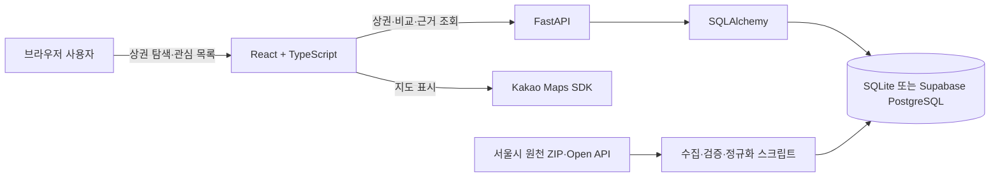
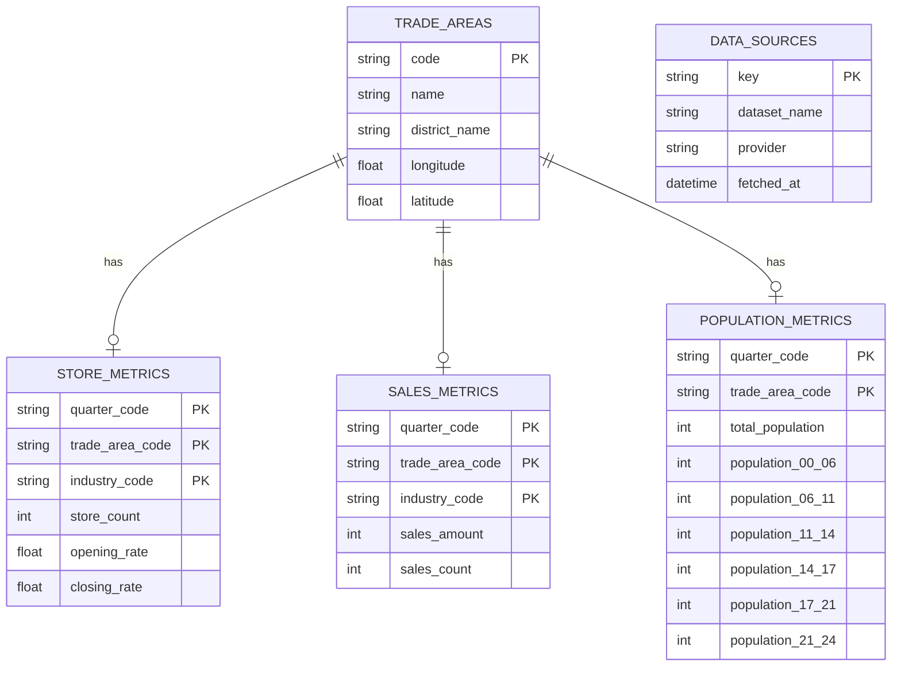

# 골목 레이더 구조와 API

## 시스템 흐름

관심 상권 코드는 브라우저 `localStorage`의 `golmok-radar:favorites:v1`에만 저장됩니다. FastAPI는 읽기 API를 제공하며 추천 점수나 사용자 프로필은 만들지 않습니다.

## 데이터 모델

점포·매출은 `기준분기 + 상권코드 + 업종코드`, 인구는 `기준분기 + 상권코드`가 논리 키입니다. 원천 행이 없으면 계산 계층은 0으로 대체하지 않고 `unavailable`과 사유를 반환합니다.

## HTTP API

| Method | 경로 | 용도 |
| --- | --- | --- |
| GET | `/health` | 앱·DB 상태 확인 |
| GET | `/api/v1/trade-areas` | 성동구·광진구 상권 목록과 데이터 보유 상태 |
| GET | `/api/v1/trade-areas/{code}` | 상권 상세와 지표 |
| POST | `/api/v1/recommendations` | 창업 성향 답변 기반 설명 가능한 카페 후보 2~3곳 |
| GET | `/api/v1/trade-areas/{code}/report` | 82개 비교군 기준 강점·주의·수요 특성 리포트 |
| GET | `/api/v1/trade-areas/{code}/rent-benchmark` | R-ONE 공간 매핑 상태와 공식 출처 확인 |
| GET | `/api/v1/comparisons?codes=A,B&quarter=20254` | 서로 다른 상권 2~4곳, 지표 14개 비교 |
| GET | `/api/v1/comparisons/{comparison_id}/evidence/{metric_key}` | 지표 출처·필터·수식·원천값 확인 |
| GET | `/api/v1/field-checklist` | 현장 확인 질문 5개 |

비교 API는 코드 1개·5개 이상·중복·없는 코드·미지원 분기를 거부합니다. 프런트엔드는 금액, 비율, 점포 수 단위를 구분하며 결측 사유를 각 셀에 표시합니다.

## 검증 기준

| 계층 | 검증 |
| --- | --- |
| 수집 | API 보고 행 수와 저장 행 수, 필수 컬럼, 기준분기 확인 |
| 적재 | 새 DB 적재, 논리 키 중복, 상권 코드 결합, 예상 행 수 확인 |
| 계산 | 정상·경계·결측 사례를 엑셀 손계산표와 pytest로 대조 |
| API | 2·3·4곳 성공 및 잘못된 코드 수·중복·분기 실패 테스트 |
| UI | 117곳 로딩, 관심 목록 유지, 최대 4곳 제한, 14지표·결측·근거 패널 확인 |

2026-10-29 로컬 통합 검증 기준으로 백엔드 32개, 프런트엔드 12개 테스트와 Vite production build가 통과했습니다. Supabase와 카카오맵의 실제 연결은 사용자 소유 연결 정보가 준비된 환경에서 별도 확인합니다.
